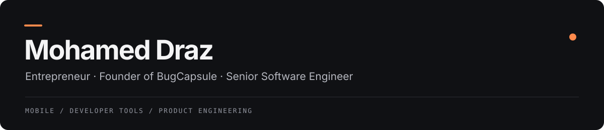

  <a href="https://bugcapsule.com">BugCapsule</a> &nbsp;·&nbsp;
  <a href="https://www.linkedin.com/in/draz26648/">LinkedIn</a> &nbsp;·&nbsp;
  <a href="mailto:mohamed.draz1198@gmail.com">Email</a> &nbsp;·&nbsp;
  <a href="https://wa.me/201028246703">WhatsApp</a>

I'm Mohamed, a self-taught software engineer and entrepreneur. I have **8+ years of experience** building applications, with a focus on Flutter, native Android and the backend systems behind them.

Today, I'm building **[BugCapsule](https://bugcapsule.com)**. My work brings together product decisions and hands-on engineering, with the same attention to the developer experience as the code underneath.

## Building BugCapsule

BugCapsule helps developers and QA teams monitor application health, investigate issues, replay supported failures and verify fixes. It brings that workflow together across Flutter, Android, iOS and web, with replay coverage depending on the platform and integration.

As its founder, I work across the SDKs, backend, dashboard and product experience. The goal is practical: give teams the context to understand a bug and evidence that a fix works.

[Explore BugCapsule](https://bugcapsule.com) &nbsp;·&nbsp; [Documentation](https://docs.bugcapsule.com/) &nbsp;·&nbsp; [Try the demo](https://bugcapsule.com/demo.html)

## Selected work

Products I've worked on across commerce, advertising and games.

| Product | What it does |
| :--- | :--- |
| [SahSeh](https://apps.apple.com/us/app/sahseh-%D8%B5%D8%AD%D8%B5%D8%AD/id1461034917) | Shopping offers and coupons. |
| [Saudi Coupons](https://apps.apple.com/us/app/saudi-coupons-%D8%B3%D8%B9%D9%88%D8%AF%D9%8A-%D9%83%D9%88%D8%A8%D9%88%D9%86/id1453175985) | Deals and savings for online shoppers. |
| [Just.ad](https://apps.apple.com/us/app/just-ad/id6757669941) | AI-assisted advertising and campaign management. |
| [Just.credit](https://apps.apple.com/eg/app/just-credit/id6759523266) | Ad account infrastructure and billing for businesses and agencies. |
| [Tawla &#124; طاولة](https://apps.apple.com/us/app/tawla-%D8%B7%D8%A7%D9%88%D9%84%D9%87/id6795340380) | Arabic-first backgammon built with Flutter and Flame, with live matches and voice chat. |
| [Biotic](https://apps.apple.com/eg/app/biotic-%D8%A8-%D9%80%D9%80%D9%8A%D9%88%D8%AA%D9%83/id6446063607) | Health and wellness commerce. |

More applications and platforms

- [Pickappo](https://play.google.com/store/apps/details?id=com.pickappo.pickappo): Delivery and logistics management.
- [Biotic Employee](https://apps.apple.com/eg/app/biotic-employee/id6445995964): Employee app for Biotic.
- [Habel | حبل](https://apps.apple.com/sa/app/habel-%D8%AD%D8%A8%D9%84/id1671346670): Freelance marketplace connecting clients and service providers.
- [KazooAndMore | كازو اند مور](https://apps.apple.com/us/app/kazooandmore/id1359353521): Retail shopping app for Kazoo in Kuwait.
- [Bimaristan | بايميرستان](https://apps.apple.com/vn/app/bimaristan/id1588577803?uo=2): Education platform with video lessons, assessments and teacher conversations.
- [One Soul](https://apps.apple.com/jo/app/one-soul-platform/id1613708979?l=ar): Youth opportunities, volunteering and learning.
- [Helpoo App](https://apps.apple.com/eg/app/helpoo/id1627316561?l=ar): Roadside assistance and accident reporting.
- Internal web dashboards for Helpoo, Biotic and Habel.

## Open source

I also build tools for the parts of development I keep coming back to.

| Project | Focus |
| :--- | :--- |
| [Flutter Craft Skills](https://github.com/draz26648/flutter_craft_skills) | Agent skills for Flutter development, including design fidelity, code quality and project conventions. |
| [Screenwise](https://pub.dev/packages/screenwise) | Responsive Flutter widgets that adapt to different screen sizes. |
| [Flutter 3D AR Converter](https://pub.dev/packages/flutter_3d_ar_converter) | Image-to-3D and augmented reality workflows using native ARKit and ARCore integrations. |
| [TensorFlow Lite Flutter](https://pub.dev/packages/tensorflow_lite_flutter) | On-device machine learning through a Dart interface to TensorFlow Lite. |

## Engineering toolkit

| Area | Technologies & practices |
| :--- | :--- |
| Mobile | Flutter, Dart, Android, Kotlin, Java |
| Backend & data | Node.js, NestJS, Express, Ruby on Rails, Firebase, PostgreSQL, MySQL, MongoDB |
| Architecture & quality | BLoC, Cubit, Riverpod, Provider, GetX, unit and integration testing |
| Delivery | Docker, GitHub Actions, CircleCI, Bitrise, Fastlane |

I'm especially interested in developer tools, AI in mobile and web products, and the details that make an interface feel good: animation, responsiveness and interaction.

---

For product conversations, engineering collaborations or a closer look at BugCapsule, reach me on [LinkedIn](https://www.linkedin.com/in/draz26648/) or [email](mailto:mohamed.draz1198@gmail.com).
